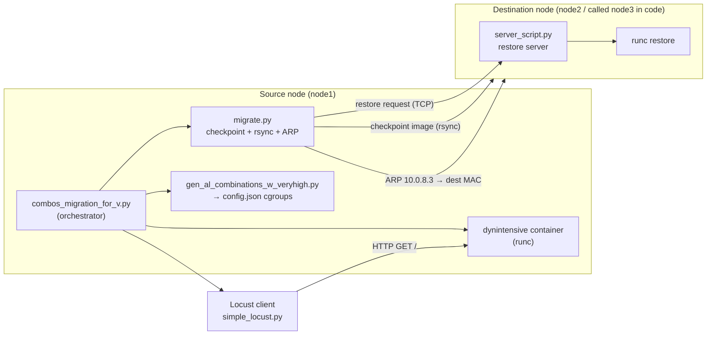

# ContMTD — Live Migration of Containerized Workloads under Contention (MTD)

This repository contains the **minimal, working set of scripts** used by the final iteration of the
ContMTD experiment: a live-migration testbed that moves a running `runc` container from a source node
to a destination node (**node1 → node2**) using **CRIU** checkpoint/restore, while the container is
under a configurable resource-contention profile and under live HTTP traffic.

The repository is a cleaned-up snapshot of a research project. All test-run artefacts (logs, CSV
datasets, ML models, plots, archived script versions, container rootfs copies, virtualenvs) have been
removed. **No script content was modified** — files are copied verbatim from the original tree, and
their original relative paths are preserved because the scripts reference them by absolute path
(`/home/ubuntu/contMTD/...`).

---

## 1. What the experiment does

For each *resource-contention combination* (CPU / memory / disk / network intensity), the orchestrator:

1. Rewrites the runtime `config.json` of the workload container to apply cgroup limits matching the combination.
2. Starts the workload container on the **source** node (`node1`).
3. Starts a **Locust** load generator against the workload endpoint (network intensity level).
4. Runs the **migration** in one of four modes:

   | Mode | `pre` flag | `post` flag | Description |
   |------|-----------|-------------|-------------|
   | **Cold** | `False` | `False` | Freeze, full checkpoint, transfer, restore. No pre-copy and no lazy pages. |
   | **Pre-copy** | `True` | `False` | One `--pre-dump` pass (transfer of the parent image) then a short final dump. |
   | **Post-copy** | `False` | `True` | Final dump uses `--lazy-pages` with a page server; memory pages stream to the destination on demand. |
   | **Hybrid** | `True` | `True` | Pre-dump pass followed by a final lazy-page dump. |

5. Migrates the service IP by **updating the gateway's ARP entry** for `10.0.8.3` so that traffic is
   redirected to the destination node's MAC address (the "IP ARP migration" step), in parallel with the
   final image transfer.
6. Asks the destination-side **restore server** to `runc restore` the container.
7. Verifies the container is running on the destination, waits for Locust metrics to settle, cleans up
   the container on both nodes, moves the ARP entry back to the source, and repeats.

The whole sequence is repeated across a set of empirically *valid* contention combinations and multiple
iterations, with periodic reboots and network-interface resets to keep the testbed stable.



---

## 2. Repository layout

```
.
├── migrate.py                                  # Source-side migration driver (checkpoint, transfer, ARP, restore request)
├── server_script.py                            # Destination-side restore server (runc restore / criu lazy-pages)
├── requirements.text                           # Python deps for the migration controller
├── system_requirements.text                    # System packages required on the nodes
├── combos_migration/
│   ├── shell_start.sh                          # Starts the dynintensive container
│   └── v_phase/
│       ├── wrapper_script.sh                   # Entry point: runs the orchestrator under the contMTD venv
│       ├── combos_migration_for_v.py           # Orchestrator: combinations, modes, Locust, cleanup, reboots
│       ├── gen_al_combinations_w_veryhigh.py   # Writes cgroup limits into /runc/containers/dynintensive/config.json
│       └── dynamic_intensive.py                # Definition of the CPU / memory / disk / network intensity levels
├── containers/
│   └── dynamic_container/                      # Workload image and traffic client
│       ├── Dockerfile                          # Builds the workload image (FastAPI + disk writer + sysstat)
│       ├── dyn_generator_w_fastAPI.py          # Workload: disk writer + FastAPI endpoint on 10.0.8.3:23456
│       ├── start_container.sh                  # Container entrypoint
│       ├── requirements.txt                    # Workload Python deps
│       └── simple_locust.py                    # Locust user hitting GET / on the workload
├── ovpn_setting/
│   ├── client.conf                             # OpenVPN TAP client config (L2 connectivity between nodes)
│   └── arp_settings/
│       └── net_cronjob.sh                      # Assigns the mobile service IP 10.0.8.3/24 to the TAP interface
└── layer2_vpn/
    └── bridge-start.sh                         # Bridges the physical NIC with the OpenVPN TAP devices
```

---

## 3. Roles of the key files

### `combos_migration/v_phase/combos_migration_for_v.py` — the orchestrator (entry point)

The "last script" that drives the whole experiment. It:

- Defines the **valid contention combinations** to run, e.g. `"vvvl"`, `"vhvh"`, `"hvv0"`, where each
  character is CPU / memory / disk / network level (`v` = very high, `h` = high, `m` = mid, `0` = no traffic).
- Defines a `real_to_defacto_valid` map: combinations that are labelled one way but must be *implemented*
  using a different ("de facto") resource profile.
- Maps network levels to Locust user counts: `l` → 10 users, `m` → 100 users, `h` → 350 users.
- For every combination × mode (`pre`/`post` combinations) it sets the cgroup config, copies
  `config.json` to the destination, starts the container, starts/stops Locust, invokes `migrate.py`,
  verifies remote state, and cleans up both nodes.
- Retries a failed migration up to 10 times, forcing a rootfs transfer every 3rd attempt.
- Reads `migration.json` to resume from the last completed combination/mode after a crash or reboot.
- Rebooting both nodes every 3 completed combination runs and resetting the network interfaces, to
  recover from CRIU/network drift during long campaigns.

### `migrate.py` — the migration driver (runs on the source node)

Arguments: `<container> <destination> [pre] [post] [with_rootfs] [combination]`

1. Optionally freezes the container cgroup, runs `runc checkpoint --pre-dump`, unfreezes, and rsyncs the
   `parent` image directory to the destination (`pre-copy` / `hybrid`).
2. Optionally resets a status pipe and runs the final `runc checkpoint` with `--lazy-pages` and a page
   server on port `27` (`post-copy` / `hybrid`); otherwise a normal final dump.
3. In parallel: transfers the final image with `rsync`, transfers `/host/<container>` disk data, and
   performs the **ARP migration** (`ssh` to the gateway and `arp -s 10.0.8.3 <destination MAC>`).
4. Sends a JSON restore request to the destination restore server and records timings to
   `/home/ubuntu/migration.json` (pre-dump time, dump time, transfer sizes/speeds, parallel phase, restore time).

### `server_script.py` — the destination restore server

A small threaded TCP server that receives a JSON request of the form:

```json
{ "restore": { "path": "/runc/containers/<container>",
               "name": "<container>",
               "image_path": "/runc/containers/<container>/image",
               "lazy": "False" } }
```

and executes `runc restore ... [--lazy-pages]` from the container's bundle directory. For lazy-page
restores it also launches `criu lazy-pages`. The measured restore duration is returned to the caller.
It also supports a `take_ip` request (deletes a keepalived trigger file and starts `keepalived`).

### `combos_migration/v_phase/gen_al_combinations_w_veryhigh.py` and `dynamic_intensive.py`

`dynamic_intensive.py` holds the concrete cgroup values for each intensity level (CPU quota/period,
memory limit, `blkio` read/write BPS and IOPS throttles) plus the Locust user counts and the measured
thresholds used to classify a combination. `gen_al_combinations_w_veryhigh.py` takes a three-letter
combination and writes the corresponding limits into `/runc/containers/dynintensive/config.json`.
The `v_phase` copies are the ones imported by the orchestrator (they log to `dyn_comb_script.log`).

### The workload (`containers/dynamic_container/`)

A Python 3.12 image that, on start, runs `dyn_generator.py`:

- a background loop that continuously writes ~1.5 GB of random data into `/data/db1.db` and `/data/db2.db`
  (disk-intensity), and
- a FastAPI server bound to `10.0.8.3:23456` serving `GET /` (a counter), which is the endpoint the
  Locust client drives.

The Dockerfile copies `dyn_generator_w_fastAPI.py` into the image as `dyn_generator.py`;
`start_container.sh` simply runs it with the two database paths.

### Networking (`layer2_vpn/`, `ovpn_setting/`)

The mobile IP `10.0.8.3` must remain reachable before, during and after migration. The testbed provides
this through an **OpenVPN TAP bridge (layer-2)** between the nodes: the TAP devices are bridged with the
physical NIC (`layer2_vpn/bridge-start.sh`), the client connects with `ovpn_setting/client.conf`, and
`ovpn_setting/arp_settings/net_cronjob.sh` assigns `10.0.8.3/24` to the TAP interface on the node that
currently owns the workload. Because both nodes are on the same L2 segment, traffic can be redirected
simply by updating the gateway's ARP entry for `10.0.8.3`.

---

## 4. Environment assumptions

These values are **hard-coded** in the original scripts and are kept unchanged:

| Item | Value used by the scripts |
|------|---------------------------|
| Source node | `node1`, `10.0.0.19` |
| Destination node | `node3`, `10.10.10.9` (management `10.0.0.31`) — the "node2" of the node1 → node2 flow |
| Gateway / Locust host | `10.0.0.152` |
| Mobile service IP under test | `10.0.8.3` |
| Source node MAC | `fa:16:3e:f7:f8:6b` |
| Destination node MAC | `fa:16:3e:e5:eb:03` |
| Container runtime directory | `/runc/containers/<name>` |
| Workload container name | `dynintensive` |
| Deployment path on all nodes | `/home/ubuntu/contMTD` |
| Collateral rootfs / disk data path | `/host/<container>` |

System prerequisites (`system_requirements.text`): `runc`, `oci-runtime-tool`, `cpulimit`, `keepalived`
plus **CRIU**, `rsync`, `openssh`, `sysstat`, `bridge-utils`/`iproute2` and OpenVPN.

Python prerequisites for the controller (`requirements.text`): `configparser`, `redis`, `setuptools`,
`thread`, `typing_extensions`. Note that both `migrate.py` and `server_script.py` import `distutils`,
so the controller must run on a Python release that still ships it (≤ 3.11, or with `setuptools` providing
the shim).

---

## 5. How to run

### 5.1 Prepare the nodes

1. Deploy this repository to `/home/ubuntu/contMTD` on the source and destination nodes (same layout).
2. Install the system packages and create the Python virtualenv used by the scripts:

   ```bash
   sudo apt-get update && sudo apt-get install -y runc criu rsync openssh-client sysstat \
        bridge-utils openvpn keepalived cpulimit
   sudo python3 -m venv /home/ubuntu/contMTD/venv
   sudo /home/ubuntu/contMTD/venv/bin/pip install -r /home/ubuntu/contMTD/requirements.text
   ```

3. Establish the layer-2 path: run `layer2_vpn/bridge-start.sh` on the VPN server side, connect the
   client with `ovpn_setting/client.conf`, and run `ovpn_setting/arp_settings/net_cronjob.sh` on the
   node that currently owns `10.0.8.3`.

4. Build the workload image and unpack it into a `runc` bundle at `/runc/containers/dynintensive`
   (the bundle must contain a `config.json` with the network namespace entry point `10.0.8.3:23456`,
   a `/home` directory holding `dyn_generator.py` and `start_container.sh`, and a writable `/data`).

5. Place the Locust client on the load-generator host (`10.0.0.152`) at `~/locust_client/simple_locust.py`
   (`containers/dynamic_container/simple_locust.py`) and install Locust there.

### 5.2 Start the destination restore server

On the destination node:

```bash
sudo /home/ubuntu/contMTD/venv/bin/python /home/ubuntu/contMTD/server_script.py
```

### 5.3 Launch the experiment

On the source node:

```bash
sudo /home/ubuntu/contMTD/combos_migration/v_phase/wrapper_script.sh
```

To detach it from the terminal (as in the original runs):

```bash
tmux new-session -d -s 0 bash -c "sudo /home/ubuntu/contMTD/combos_migration/v_phase/wrapper_script.sh"
```

Results accumulate in `/home/ubuntu/migration.json` (one JSON record per migration with the mode,
resource levels and per-phase timings) and in `/home/ubuntu/dyn_migration_script.log`.

### 5.4 Run a single migration manually

```bash
# cold
sudo /home/ubuntu/contMTD/venv/bin/python /home/ubuntu/contMTD/migrate.py dynintensive 10.10.10.9 False False False mmmm
# pre-copy
sudo /home/ubuntu/contMTD/venv/bin/python /home/ubuntu/contMTD/migrate.py dynintensive 10.10.10.9 True  False False mmmm
# post-copy
sudo /home/ubuntu/contMTD/venv/bin/python /home/ubuntu/contMTD/migrate.py dynintensive 10.10.10.9 False True  False mmmm
# hybrid
sudo /home/ubuntu/contMTD/venv/bin/python /home/ubuntu/contMTD/migrate.py dynintensive 10.10.10.9 True  True  False mmmm
```

---

## 6. Operational notes and known caveats

These are observations about the snapshot as-is; **the scripts were not modified** when building this
repository.

- **Restore port mismatch.** `migrate.py` opens the restore request to port **8887**
  (`cs.connect((dest, 8887))`), while the included `server_script.py` binds port **8888**. Align the two
  (by configuring the service to listen on the port the driver uses) before running.
- **Hard-coded node identities.** Node IPs, MAC addresses, interface names (`ens4`, `ens7`, `ens8`,
  `ens3`) and the deployment path are constants in the scripts and must match the testbed.
- **Locust intensity.** `l` → 10 users, `m` → 100 users, `h` → 350 users, started with
  `--headless -r 100` against `http://10.0.8.3:23456`.
- **Rootfs transfer** is disabled by default and only forced on every third failed attempt
  (`with_rootfs` becomes `True` when `fail_count % 3 == 0`).
- **Long campaigns are self-healing**: the orchestrator reboots both nodes after every 3 combination runs
  and flushes/resets interfaces to recover from CRIU and network state drift; `migration.json` is used to
  resume from the last completed point.
- **Hardware/environment sensitivity.** Measured behaviour depends on the exact node hardware, kernel,
  CRIU version and link speed used in the original testbed; the thresholds recorded in
  `dynamic_intensive.py` were calibrated on that setup.

---

## 7. What was intentionally excluded

The original working tree contained a large amount of material that is not part of the final workflow:
older script generations and backups (`*_backup`, `archive/`, `sigcomm_revision/`), alternative
workloads (`dyn_generator.py`, `dyn_generator_w_flask.py`, `dyn_generator_w_net.py`, `dyn_script.py`),
alternative combination generators (`gen_al_combinations*.py` outside `v_phase`, `valid_combos*.json`),
test and resume utilities (`resume_test.sh`, `testing_resume_logic.py`, `stateless_time_measurements.py`),
data-collection/analysis tooling (`log_parse/`, `v_log_parse/`, `containers/utils/`, plotting and ML
notebooks and models), container rootfs trees, Kubernetes/`kubectl`-based migration experiments
(`containers/migration/`, `migrate_node1_to_node3.sh`), experiment logs and CSV datasets, Docker build
contexts for other workloads, and the local `venv/`.
