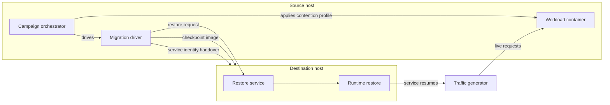

# ContMTD

**Live migration of containerized workloads under multi-dimensional resource contention.**

ContMTD is a systems platform for relocating running containers between hosts without interrupting the
services they provide. It combines OCI-native checkpoint and restore with a programmable contention
model, continuous production-like traffic, and transparent network-level continuity, so that a workload
can change hosts while it is already saturating its CPU, memory, disk, and network budgets.

ContMTD is the reference implementation accompanying our research. It is intended both as the artifact
for reproducing our results and as a platform on which further work on contention-aware migration can
be built.

---

## Overview

Container migration is routinely evaluated on idle workloads, yet real services run under sustained,
multi-resource pressure. ContMTD treats contention as a first-class property of the migration lifecycle
rather than as background noise: every migration is executed against an explicit, reproducible resource
profile, under live client traffic, and with the service's network identity carried across the host
boundary.

The platform covers the complete path from workload instantiation to post-migration service continuity,
and it records each relocation as a structured performance record suitable for analysis and modelling.

---

## Design

**Contention as a programmable dimension.** Each workload is instantiated under a resource profile that
specifies CPU, memory, block I/O, and network intensity. Profiles are generated programmatically, applied
through the container runtime's control-group interface, and can be composed into campaigns that span
the contention space.

**Transport-agnostic migration strategies.** The platform implements cold, pre-copy, post-copy, and
hybrid relocation as points on a single continuum, sharing the same control path, telemetry, and
validation logic.

**Service continuity, not just state restoration.** Process state is only one part of a live service.
ContMTD additionally carries the service's network identity across hosts and keeps client traffic
flowing throughout the handover, so correctness is observed from the client's perspective.

**Measurement as part of the system.** Timing, transferred volume, and throughput for every phase of a
relocation are captured by the platform itself, making results reproducible without external
instrumentation.

---

## Architecture



The **campaign orchestrator** enumerates contention profiles and migration strategies, controls workload
and traffic lifecycles, and sequences long-running campaigns with recovery between iterations.

The **migration driver** performs checkpointing, image transfer, network identity handover, and the
restore request, executing phase-specific work concurrently where the strategy allows.

The **restore service** runs on the destination host and performs the runtime restore, including
lazy-page handling for strategies that require it.

---

## Migration strategies

| Strategy | Mechanism | Characteristic |
|----------|-----------|----------------|
| **Cold** | Freeze, full checkpoint, transfer, restore | Simplest transfer path; interruption equals the full state transfer |
| **Pre-copy** | Iterative pre-dump followed by a short final dump | Transfers the bulk of memory ahead of the freeze window |
| **Post-copy** | Lazy page transfer from the source during execution at the destination | Keeps the freeze window short at the cost of post-resume page faults |
| **Hybrid** | Pre-dump followed by lazy page transfer | Combines bulk pre-transfer with a short interruption |

---

## Components

| Area | Implementation |
|------|----------------|
| Migration control plane | `migrate.py`, `server_script.py` |
| Campaign orchestration | `combos_migration/v_phase/`, `combos_migration/shell_start.sh` |
| Contention model | `dynamic_intensive.py`, `gen_al_combinations_w_veryhigh.py` |
| Workload and traffic | `containers/dynamic_container/` |
| Network continuity | `layer2_vpn/`, `ovpn_setting/` |

The workload generator sustains disk write pressure while exposing an HTTP service interface, and the
bundled traffic generator exercises that interface throughout a relocation. Network continuity is
provided by a layer-2 interconnect between hosts, allowing the service address to follow the workload
without reconfiguration of clients.

---

## Repository structure

```
.
├── migrate.py                     Migration driver: checkpoint, transfer, identity handover
├── server_script.py               Restore service for the destination host
├── requirements.text              Python dependencies
├── system_requirements.text       System dependencies
├── combos_migration/
│   ├── shell_start.sh             Workload lifecycle
│   └── v_phase/
│       ├── wrapper_script.sh      Campaign entry point
│       ├── combos_migration_for_v.py     Campaign orchestration
│       ├── gen_al_combinations_w_veryhigh.py   Contention profile application
│       └── dynamic_intensive.py   Contention model
├── containers/
│   └── dynamic_container/
│       ├── Dockerfile
│       ├── dyn_generator_w_fastAPI.py     Workload generator and service endpoint
│       ├── start_container.sh
│       ├── requirements.txt
│       └── simple_locust.py       Traffic generator
├── ovpn_setting/
│   ├── client.conf                Layer-2 interconnect client
│   └── arp_settings/
│       └── net_cronjob.sh         Service address assignment
└── layer2_vpn/
    └── bridge-start.sh            TAP bridging for the layer-2 interconnect
```

---

## Getting started

**Prerequisites.** An OCI-compatible container runtime with checkpoint/restore support, CRIU, a Python 3
environment, a load generator, and a layer-2 interconnect between the participating hosts. Dependency
manifests are provided as `system_requirements.text` and `requirements.text`.

```bash
pip install -r requirements.text
```

**Deployment.**

1. Distribute the platform to every host participating in the deployment.
2. Build the workload image from `containers/dynamic_container/` and register it with the runtime.
3. Start the restore service on the destination host:

   ```bash
   sudo python3 server_script.py
   ```

4. Launch a migration campaign from the source host:

   ```bash
   sudo combos_migration/v_phase/wrapper_script.sh
   ```

Deployment-specific parameters, such as host identities, interface names, and contention profiles, are
supplied by the operator for each environment. A single relocation can also be issued directly through
the migration driver by selecting the migration strategy through its pre-copy and post-copy controls.

---

## Citation

The design and evaluation of ContMTD are presented in the accompanying paper. Citation details will be
published here.

