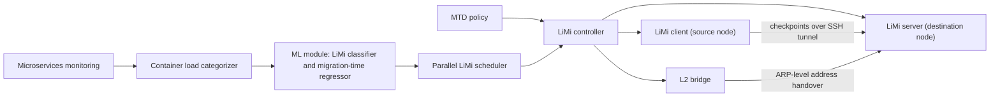

# ContMTD

**Live Migration Optimization for Containers in Moving Target Defense**

Cloud infrastructure is increasingly container-based, and Moving Target Defense (MTD) has become a
practical way to raise the cost of attacks against it. Live migration (LiMi) is one of the most
attractive MTD primitives, but its value depends entirely on how the migration is performed: no single
LiMi method is optimal for every container, and migrating a multi-container application requires its
containers to be restored together.

ContMTD is a container-based MTD framework for stateful microservices. It characterizes each container
by its CPU, memory, storage, and network load, and uses that characterization both to select the most
suitable LiMi method for every container and to schedule the parallel migration of a complete
application. An MTD policy that keeps stateless components at the exposed edge of the service further
prevents an existing infection from being carried into the new instance.

Across randomly generated microservice scenarios, ContMTD reduces average migration downtime by up to
42% compared with the state of the art, and improves security outcomes against side-channel exfiltration
and stealthy malware propagation by 5-10%. The codebase and the LiMi dataset behind it are open source.

## Contributions

- **LiMi optimization.** An ML module selects the optimal LiMi method per container and improves the
  scheduling of multi-container migrations.
- **Enhanced MTD strategy.** A policy that integrates stateless components into the migration process,
  reducing the risk of transferring an infection to the new instance.
- **Open LiMi dataset.** Measurements of 5890 validated live migrations, covering 34 container load
  categories and the four LiMi methods, published together with the codebase.

---


## Design

### Migration strategies

| Method | Description |
|--------|-------------|
| **Basic (cold)** | Freeze the container, checkpoint it, transfer the checkpoint, restore at the destination, and redirect client traffic |
| **Pre-copy** | Transfer state while the container keeps running; the final transfer only carries the data produced since the pre-dump |
| **Post-copy** | Freeze at the start of the migration, transfer only the minimal state required to restore, then send the remaining pages while the service runs at the destination |
| **Hybrid** | Perform a pre-dump and then proceed with the post-copy method |

No single method is optimal for every workload: pre-copy and hybrid tend to minimize downtime, whereas
post-copy and hybrid risk QoS degradation, and the best choice depends on the container's load profile.
ContMTD determines that choice per container and coordinates the resulting migrations, instead of
applying one method to an entire application.

### Container load categorization

A container is described by four metrics - CPU load, memory load (high memory dirty-page rate), storage
load (disk read/write operations), and network load (packet throughput) - each quantized into three
intensity levels (low, medium, high), with an additional *very low* level for network to cover
computational or idle containers. The resulting space of 3 x 3 x 3 x 4 = 108 categories is reduced to the
34 combinations that are achievable in practice, since resource bottlenecks make the remaining ones
infeasible; the intensity labels are then corrected according to the measured *de facto* consumption of
each container.

### Migration optimization workflow

1. The containers to be migrated are monitored and categorized.
2. The migration method is selected, either by a downtime regressor feeding a classifier, or directly by
   a classifier such as the statistical heuristic proposed in the paper.
3. A regression model predicts the total migration time of the container and the chosen method.
4. The scheduler computes the start time of each migration so that all containers of the application are
   restored at approximately the same time.

### MTD policy

ContMTD applies *stateless-ification*: the service is decomposed so that its externally exposed
components are stateless and mediate all access to the stateful ones. Frequently migrating the exposed
stateless containers removes malware and persistent threats from the attack surface, while stateful
migrations are reserved for proactive defense against side-channel attacks. This avoids propagating an
existing infection into the new instance, which live migration of a stateful container alone cannot
prevent.

---

## Architecture



The LiMi client and server exchange checkpoints over an encrypted tunnel, with a `sync` that
transfers only the difference between the new checkpoint and any image already present at the destination. For stateful migrations, CRIU preserves established TCP connections, and the L2 bridge
migrates the container's IP address at the ARP table level, keeping those sessions alive across the
move. When the application has a writable root filesystem, the checkpoint delta and the volume delta
are transferred in parallel to reduce downtime.

---

## Evaluation highlights

- An average downtime reduction of 42% with the heuristic selector and 40% with the Random Forest
  selector, relative to the state-of-the-art parallel migration scheme, with ContMTD performing better in
  95% of the evaluated cases.
- A 71% average reduction in container misalignment when scheduling parallel migrations of a
  multi-container application.
- 4% fewer exfiltrated containers and 5% fewer exfiltrated data units in the side-channel scenario, and
  a 10-12% lower attack success rate in the stealthy malware scenario.

---

## Getting started

**Prerequisites.** An OCI-compatible container runtime with checkpoint/restore support (CRIU), a Python 3
environment, a Locust load generator, and a layer-2 interconnect between the participating hosts.
Dependency manifests are provided as `system_requirements.text` and `requirements.text`.

```bash
pip install -r requirements.text
```

**Deployment.**

1. Distribute the platform to every host participating in the deployment.
2. Build the benchmarking container from `containers/dynamic_container/` and register it with the
   runtime.
3. Start the LiMi server on the destination host:

   ```bash
   sudo python3 server_script.py
   ```

4. Launch a migration campaign from the source host:

   ```bash
   sudo combos_migration/v_phase/wrapper_script.sh
   ```

Deployment-specific parameters, such as host identities, interface names, and load profiles, are
supplied by the operator for each environment. A single migration can also be issued directly through
the LiMi client by selecting the method through its pre-copy and post-copy controls.

---

## Citation

W. Soussi, G. Cantali, G. Gür, and B. Stiller, "ContMTD: Live Migration Optimization for Containers in
Moving Target Defense."

The codebase and the LiMi dataset are published at https://github.com/wsoussi/ContMTD.

